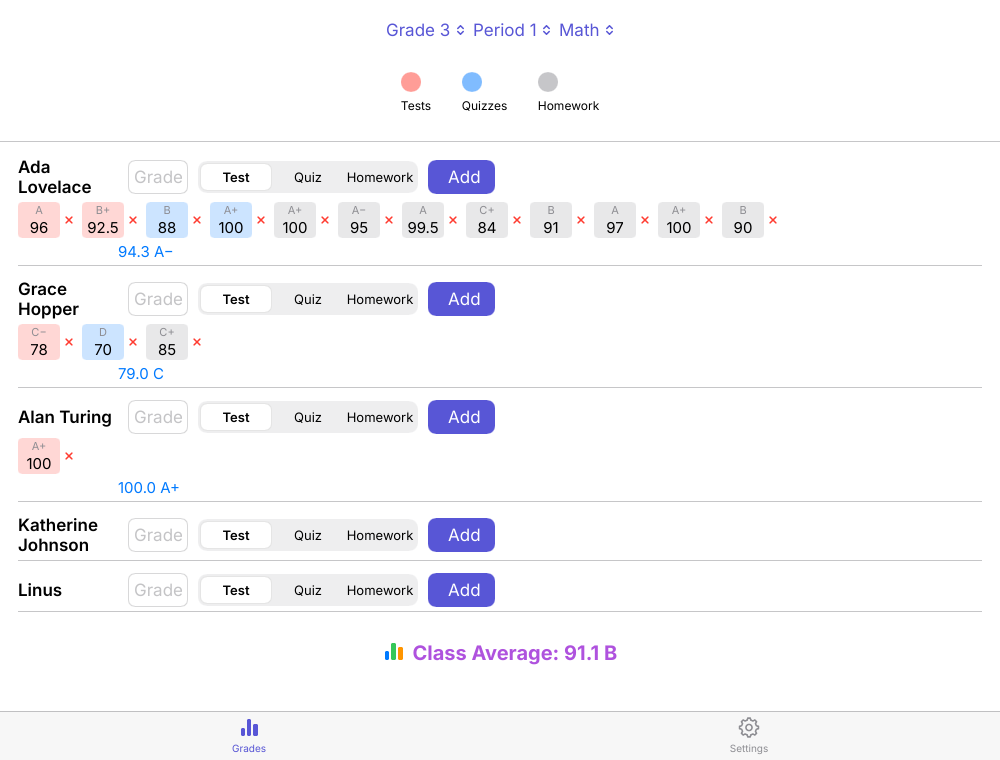
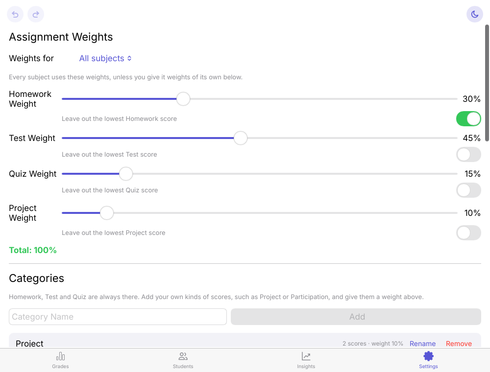

<div align="center">


# GradeBook

**A fast, friendly gradebook for teachers and homeschoolers.**<br>
Weighted averages, letter grades and one-click backups, as a native app for Windows, macOS and Linux.

[](https://github.com/JMTDI/GradeBook/actions/workflows/desktop.yml)


[](https://github.com/JMTDI/GradeBook/releases/latest)
[](https://github.com/JMTDI/GradeBook/releases/latest)
[](https://github.com/JMTDI/GradeBook/releases/latest)

[Features](#features) · [Install](#install) · [Using the app](#using-the-app) · [Your data](#your-data) · [Build from source](#build-from-source)

<picture>
  <source media="(prefers-color-scheme: dark)" srcset="docs/screenshots/grades-dark.png">
  
</picture>

</div>

## Features

- 📚 **Organised the way you teach.** Grade levels 1–10, six periods and 20 subjects, one class at a time.
- ⚖️ **Weighted averages.** Tests, quizzes and homework count as much as you decide (50 / 17 / 33 to begin with). The weights re-balance on their own for students who don't have every type of grade yet.
- 🔤 **Letter grades that add up.** From A+ to F, including fractional scores: 91.5 is a B and 99.5 is an A.
- 🌗 **Light and dark.** It follows your system's setting.
- 💾 **Saves as you go.** Every change is written to disk straight away, in a way that can't leave a half-written file behind.
- 🛟 **Backup and Restore.** The whole gradebook goes into one JSON file, and a restore keeps a safety copy of whatever it replaces.
- ⚡ **Light on your computer.** A native Rust app built with [Slint](https://slint.dev): no browser engine and no GPU needed. On Linux the window opens in about half a second and the app idles at around 20 MB of memory.
- 📦 **Installers for every system.** A Windows `.exe`, a macOS universal `.dmg`, and a Linux `.deb` and AppImage.

## Install

Download the installer for your system from the [Releases page](https://github.com/JMTDI/GradeBook/releases/latest).

| System | File | How to install |
|---|---|---|
| **Windows** 10/11 (64-bit) | `GradeBook-<version>-windows-x64-setup.exe` | Run it. It installs for your user only, so no administrator rights are needed. |
| **macOS** 11+ (Apple Silicon and Intel) | `GradeBook-<version>-macos-universal.dmg` | Open it and drag GradeBook to Applications. |
| **Debian, Ubuntu** and derivatives | `gradebook_<version>-1_amd64.deb` | `sudo apt install ./gradebook_<version>-1_amd64.deb` |
| **Any other 64-bit Linux** | `GradeBook-<version>-x86_64.AppImage` | `chmod +x` it and run it. If it doesn't start, install `libfuse2` or run it with `--appimage-extract-and-run`. |

> [!NOTE]
> The installers aren't code-signed, so your system may warn you the first time you open GradeBook.
> - **Windows:** SmartScreen may say "Windows protected your PC". Choose **More info → Run anyway**.
> - **macOS:** the app isn't notarized, so the first time, right-click it and choose **Open** (or run `xattr -dr com.apple.quarantine /Applications/GradeBook.app`).

Backup and Restore open your system's file chooser. On Linux that is the desktop portal
(`xdg-desktop-portal`), falling back to `zenity`.

## Using the app

Two screens, with a tab bar at the bottom to switch between them.

### Grades

Choose a grade level (1–10), a period (1–6) and a subject (20 to choose from). Every student in that
grade level gets a row. Choose **Test**, **Quiz** or **Homework**, type a score (decimals work:
`92.5`, or `92,5`) and click **Add**. Scores appear as chips tinted by type (red for tests, blue for
quizzes, grey for homework) with their letter grade, and the red × beside a score deletes it. Under
the chips is the student's weighted average with its letter grade, and the class average is at the
bottom.

### Settings

Add students (a name and a grade level), set the weights of tests, quizzes and homework
(50 / 17 / 33 to begin with; the total is shown), and use Backup and Restore. To delete a student,
hover over the row and click the red minus (or focus the row and press <kbd>Delete</kbd>), then
confirm with the red **Delete** button.

<p align="center">
  <picture>
    <source media="(prefers-color-scheme: dark)" srcset="docs/screenshots/settings-dark.png">
    
  </picture>
</p>

### How averages work

The scores of each type are averaged first, then combined using the weights. The weights are
re-balanced over the types a student has scores for, so a student with only tests is graded on tests
alone.

For example, Ada in the screenshot at the top has tests of 96 and 92.5 (average 94.25), quizzes of
88 and 100 (average 94) and eight homework scores that average 94.56. With the default weights
that makes 0.50 × 94.25 + 0.17 × 94 + 0.33 × 94.56 ≈ 94.3, an A−.

### Letter grades

Each letter starts at the score shown, so 91.5 is a B and 99.5 is an A. The letter next to an
average always matches the rounded number displayed.

| Letter | A+ | A | A− | B+ | B | B− | C+ | C | C− | D | E | F |
|---|---|---|---|---|---|---|---|---|---|---|---|---|
| **From** | 100 | 96 | 94 | 92 | 88 | 86 | 84 | 79 | 76 | 70 | 63 | 0 |

> [!TIP]
> GradeBook follows your system's light or dark setting. To pick one yourself, set the `GRADEBOOK_THEME` environment variable to `light` or `dark`.

## Your data

GradeBook saves after every change, in `gradebook.json` in:

| System | Folder |
|---|---|
| Windows | `%APPDATA%\JMTDI\GradeBook\data` |
| macOS | `~/Library/Application Support/io.github.JMTDI.GradeBook` |
| Linux | `~/.local/share/gradebook` |

`gradebook --data-dir` prints the exact folder on Linux (on macOS run
`/Applications/GradeBook.app/Contents/MacOS/gradebook --data-dir`; the Windows build has no
console window, so use the folder above). Set `GRADEBOOK_DATA_DIR` to keep the data somewhere
else (for example on a USB stick). Uninstalling never deletes it.

### Backup and Restore

In Settings, **Backup** writes a `GradeBookBackup.json` file and **Restore** reads one, so you can
keep a copy of your gradebook or move it to another computer. Restoring replaces everything, so the
app asks first and saves a copy of the data it replaces next to `gradebook.json`, as
`gradebook.before-restore-<time>.json` (one per restore, never overwritten). If that copy can't be
saved, the restore doesn't go ahead.

### If something goes wrong

If the data file can't be read (for example, it was damaged), GradeBook moves it aside as
`gradebook.unreadable-<time>.json`, tells you, and starts with an empty gradebook. It never
overwrites that file.

## Build from source

You need [Rust](https://rustup.rs) 1.92 or newer. On Linux you also need `pkg-config` and
`libfontconfig1-dev` (Debian/Ubuntu names).

```sh
cargo run --release     # build and start the app
cargo test              # logic, headless UI interaction tests and screenshots
```

The tests drive the real UI without a window: they click, type, drag sliders and read what's on
screen, and write PNG screenshots of every screen to `target/tmp/screenshots`.

`cargo run --example make_icons` regenerates the icons in `assets/icons` from `assets/AppIcon.png`.

<details>
<summary><b>Linux run-time libraries</b></summary>

At run time on Linux the app loads the system's X11 or Wayland libraries (the `.deb` depends on
them): `libx11-6`, `libx11-xcb1`, `libxcb1`, `libxcb-xkb1`, `libxcursor1`, `libxext6`,
`libxfixes3`, `libxi6`, `libxrender1`, `libxkbcommon0` and `libxkbcommon-x11-0`, plus
`libwayland-client0` and `libwayland-cursor0` on Wayland.

</details>

<details>
<summary><b>Build the installers</b></summary>

Each one is built on its own operating system; the GitHub Actions workflow
([`desktop.yml`](.github/workflows/desktop.yml)) does all three.

```sh
# Linux .deb (needs `cargo install cargo-deb`)
cargo build --release && cargo deb --no-build

# Linux AppImage (needs appimagetool on PATH)
cargo build --release && packaging/linux/build-appimage.sh

# macOS universal .dmg (run on a Mac)
rustup target add aarch64-apple-darwin x86_64-apple-darwin
cargo build --release --target aarch64-apple-darwin
cargo build --release --target x86_64-apple-darwin
packaging/macos/build-dmg.sh

# Windows installer (needs NSIS; run from the project folder)
cargo build --release
mkdir dist
makensis /DVERSION=1.0.0 /DROOT=%CD% packaging\windows\installer.nsi
```

`packaging/linux/smoke-test.sh <binary>` starts a built binary under a virtual X display
(`xvfb-run`) and checks that its window appears and stays up.

To publish, bump `version` in `Cargo.toml` and push a tag named `v<version>`. The
workflow builds everything and attaches the installers to a GitHub release.

</details>

<details>
<summary><b>Code signing</b></summary>

Nothing is signed or notarized, which is why Windows and macOS show a warning on first launch.
Removing it takes a certificate you own: an Authenticode certificate for Windows, and an Apple
Developer ID plus notarization for macOS. The macOS app is signed ad hoc, which Apple Silicon
needs in order to run it at all.

</details>

## Project layout

```
src/        model.rs, calc.rs, book.rs, view.rs  the gradebook logic (no UI)
            store.rs                             data file, Backup/Restore files
            app.rs                               connects the UI to the logic
ui/         *.slint                              the screens and controls
tests/      interaction.rs, screenshots.rs       headless UI tests
packaging/  linux/, macos/, windows/             installers
assets/     icons/                               the app icons
examples/   make_icons.rs                        regenerates assets/icons
docs/       screenshots/                         the images in this README
```

## Licenses

GradeBook uses the following third-party software, which is redistributed in the app:

- [Slint](https://slint.dev), under its royalty-free desktop license, which asks for the
  attribution below. Slint is also available under the GPLv3 or a commercial license.
- The [Inter](https://rsms.me/inter/) typeface, under the SIL Open Font License
  ([`ui/fonts/Inter-OFL.txt`](ui/fonts/Inter-OFL.txt), included in every package).
- Open-source Rust crates, each under its own license. `cargo tree` lists them.

<!-- The Slint royalty-free license requires this attribution on a public page where the
     binaries can be downloaded. If you switch to the GPLv3 or a commercial Slint license,
     see https://slint.dev/pricing and adjust. -->
<div align="center">

<picture>
  <source media="(prefers-color-scheme: dark)" srcset="https://raw.githubusercontent.com/slint-ui/slint/master/logo/MadeWithSlint-logo-light.png">
  <a href="https://slint.dev"></a>
</picture>

</div>
